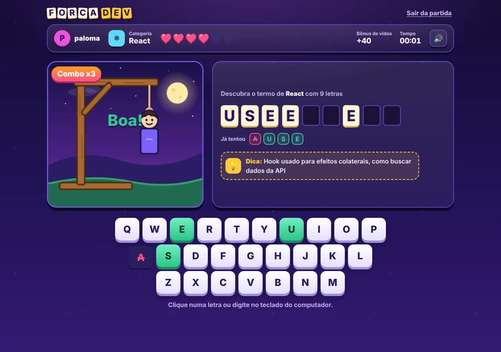
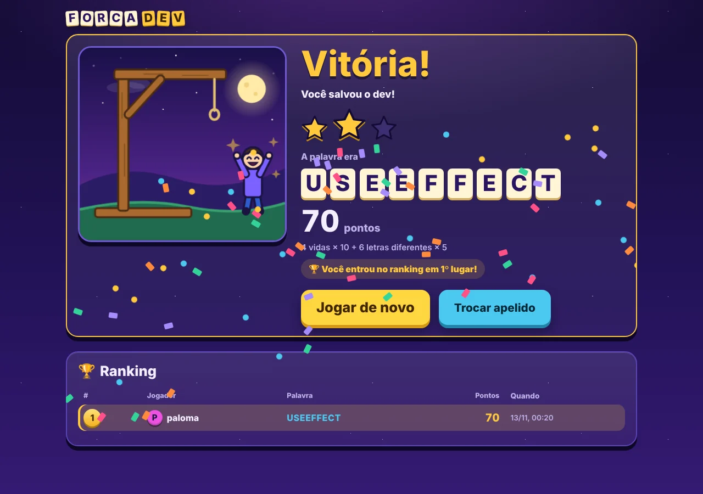

<h1 align="center">FORCA DEV</h1>

<p align="center">
  <strong>Adivinhe o termo de programação antes que o dev vá para a forca.</strong>
</p>

<p align="center">
  Um jogo da forca com desafios de programação, partidas animadas e ranking de jogadores.
</p>

<p align="center">
  
</p>

## O que é o Forca Dev?

O **Forca Dev** é uma versão do clássico jogo da forca feita para quem gosta de tecnologia. Em vez de palavras aleatórias, você tenta descobrir **termos do universo da programação**.

Escolha um apelido, selecione a dificuldade e comece a adivinhar. Cada letra errada custa uma vida. Acerte a palavra para ganhar pontos e disputar uma posição no ranking.

### O que você encontra no jogo

- **4 dificuldades:** Surpresa, Fácil, Médio e Difícil.
- **Ranking de jogadores:** compare suas pontuações e conquiste uma posição no placar.
- **6 vidas por partida:** pense antes de escolher cada letra.
- **Dicas:** troque uma vida por uma pista quando precisar de ajuda.
- **Animações e efeitos sonoros:** cenário, personagens e reações que acompanham a partida.
- **Teclado interativo:** jogue clicando nas letras ou usando o teclado do computador.
- **Versão responsiva:** interface adaptada para computador e celular.

## Veja o jogo por dentro

Estas são **capturas reais do projeto**, não mockups.

<table>
  <tr>
    <th align="center">Tela inicial e ranking</th>
    <th align="center">Resultado da partida</th>
  </tr>
  <tr>
    <td></td>
    <td></td>
  </tr>
</table>

<p align="center">
  <strong>Também funciona em telas menores</strong>
</p>
<p align="center">
  
</p>

## Baixar e jogar

**[Baixar o projeto em ZIP](https://github.com/palomagl/jogo-da-forca/archive/refs/heads/main.zip)** · **[Explorar o código no GitHub](https://github.com/palomagl/jogo-da-forca)**

> **Importante:** este repositório contém o **código-fonte**, não um instalador (.exe). Para jogar no seu computador, é preciso iniciar o servidor e a interface seguindo os passos abaixo.

### O que precisa ter instalado

- [Node.js](https://nodejs.org/) **20.19+ ou 22.12+**, com npm.
- Um terminal (PowerShell, Prompt de Comando ou equivalente).

### 1. Baixe e extraia o ZIP

Abra a pasta extraída do projeto em um terminal e execute:

```bash
cd backend
npm install
```

Crie o arquivo `.env` a partir do exemplo:

```bash
# Windows (PowerShell)
Copy-Item .env.example .env

# macOS / Linux
# cp .env.example .env
```

Depois, ainda na pasta `backend`:

```bash
npx prisma migrate dev
npm run seed
npm run dev
```

Deixe esse terminal aberto: ele mantém o servidor do jogo funcionando.

### 2. Inicie o jogo

Abra **outro terminal na pasta principal do projeto** e execute:

```bash
cd frontend
npm install
npm run dev
```

Abra **http://localhost:5173** no navegador e comece a jogar.

## Tecnologias

**React · TypeScript · Vite · Node.js · Fastify · Prisma · SQLite**

O jogo tem frontend e backend separados. A palavra secreta permanece no servidor durante a partida, e o navegador recebe apenas as letras reveladas.

Para quem quiser conhecer o desenvolvimento, há também a [documentação da API](docs/api.md), o [planejamento](docs/planejamento.md) e as [decisões técnicas](docs/decisoes.md).

---

<p align="center">
  Desenvolvido por <a href="https://github.com/palomagl">@palomagl</a>.
</p>
