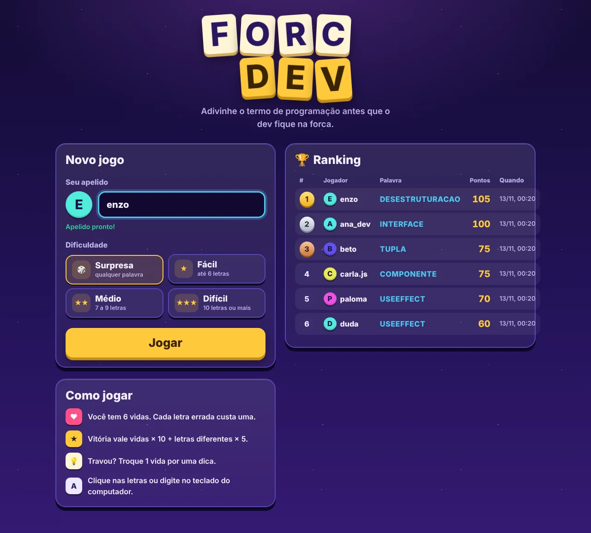
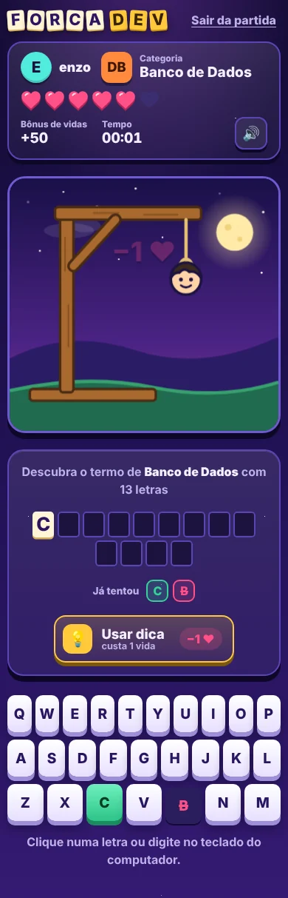

# Forca Dev

Jogo da forca com termos de programação. O jogador informa um apelido, o servidor sorteia uma palavra secreta guardada no SQLite e o jogador chuta letras. Com 6 erros, perde; revelando a palavra, vence, ganha pontos e entra no ranking.

A palavra secreta **nunca sai do servidor** enquanto a partida está em andamento: o front recebe só a máscara (ex.: `PR_M_SE`).


| Tela inicial | Fim de jogo | Celular |
|---|---|---|
|  |  |  |

## O que tem no jogo

- **Cenário animado em SVG:** céu noturno com estrelas, lua, morros e a forca de madeira. A cada erro aparece uma parte do boneco, e o rosto dele muda de humor conforme as vidas acabam. Na derrota ele balança; na vitória sai da forca comemorando.
- **Palavra em peças** que viram quando a letra é revelada. No fim, as letras que faltaram aparecem em rosa.
- **Teclado com relevo** (layout QWERTY): verde no acerto, rosa e riscado no erro. Também dá para jogar pelo teclado do computador.
- **HUD da partida:** avatar do jogador, categoria, corações que quebram, bônus de vidas, cronômetro e botão de som.
- **Reações a cada palpite:** o palco treme no erro, aparecem "Boa!" e "−1 ♥" flutuando, e um selo de combo para acertos seguidos.
- **Efeitos sonoros** gerados pelo próprio navegador (Web Audio API), sem arquivos de áudio. Dá para desligar e a escolha fica salva.
- **Fim de jogo:** até 3 estrelas pela quantidade de vidas, pontos subindo, confete na vitória e a sua posição no ranking.
- **Ranking** com medalhas de ouro, prata e bronze e destaque para a partida que acabou de terminar.
- **Dica paga** (custa 1 vida) e **níveis de dificuldade** (Surpresa, Fácil, Médio, Difícil).
- Funciona no celular e respeita a opção do sistema de reduzir animações.

## Tecnologias

| Parte     | Tecnologias |
|-----------|-------------|
| Back-end  | Node.js, TypeScript (strict), Fastify 5, Zod 4, Prisma ORM 6.19.3, SQLite, Vitest |
| Front-end | React 19, TypeScript (strict), Vite, SVG + CSS para as animações, Web Audio API para os sons |

Bônus implementados: teclado físico, desenho da forca em SVG, dica paga (`POST /api/partidas/:id/dica`) e níveis de dificuldade.

## Pré-requisitos

- **Node.js 20.19+ ou 22.12+** (confira com `node -v`)
- npm (vem com o Node)
- Git

## Como rodar

São dois terminais: um para o back-end (porta 3333) e outro para o front-end (porta 5173).

### 1. Back-end

```bash
cd backend
npm install
cp .env.example .env          # no Windows (cmd): copy .env.example .env
npx prisma migrate dev        # cria prisma/forca.db, aplica a migration e gera o Prisma Client
npm run seed                  # cadastra as 34 palavras
npm run dev                   # API em http://localhost:3333
```

Teste rápido: abra http://localhost:3333/api/ranking no navegador, que deve mostrar `[]`.

### 2. Front-end (em outro terminal)

```bash
cd frontend
npm install
npm run dev                   # abre em http://localhost:5173
```

O Vite repassa as chamadas `/api/...` para `http://localhost:3333` (proxy em `vite.config.ts`), então o back-end precisa estar rodando.

## Testes

```bash
cd backend
npm test
```

São 38 testes no Vitest:

- `tests/regras.test.ts`: as regras do jogo como funções puras (RN01 a RN06 e bônus).
- `tests/api.test.ts`: as rotas, com `app.inject` do Fastify (status, formato `{ erro }`, vitória, derrota, ranking).

Os testes usam um banco separado (`prisma/test.db`, criado automaticamente por `tests/setup-banco.ts`), então o `forca.db` do jogo não é apagado.

## Scripts úteis

| Pasta      | Comando             | O que faz |
|------------|---------------------|-----------|
| `backend`  | `npm run dev`       | API com recarga automática (tsx watch) |
| `backend`  | `npm run seed`      | Cadastra/atualiza as palavras (pode rodar de novo sem duplicar) |
| `backend`  | `npm test`          | Roda os testes |
| `backend`  | `npm run typecheck` | Checa os tipos do TypeScript |
| `backend`  | `npm run db:studio` | Abre o Prisma Studio para ver os dados |
| `frontend` | `npm run build`     | Checa os tipos e gera a versão de produção |

## Estrutura

```
forca-dev/
├── backend/
│   ├── prisma/            schema.prisma e migrations/
│   ├── src/
│   │   ├── database/      prisma.ts (PrismaClient único) e seed.ts
│   │   ├── game/          regras.ts (funções puras)
│   │   ├── repositories/  acesso ao banco (Prisma)
│   │   ├── services/      regras + banco: monta a resposta da API
│   │   ├── controllers/   validam a entrada (Zod) e chamam o service
│   │   ├── routes/        plugin Fastify com as rotas
│   │   ├── schemas/       schemas Zod
│   │   └── app.ts         criarApp() + setErrorHandler
│   └── tests/
├── frontend/src/
│   ├── api/               cliente tipado da API
│   ├── components/        Cenario, Mascara, Teclado, Hud, Vidas, Ranking, Estrelas, Confete, …
│   ├── hooks/             useRanking, useFeedback, useCronometro, useContagem
│   ├── lib/               jogo.ts (funções auxiliares) e som.ts (efeitos sonoros)
│   ├── pages/             TelaInicial, TelaJogo, TelaFim
│   └── App.tsx
└── docs/                  planejamento, API, decisões e diário de bordo
```

## Documentação

- [Planejamento](docs/planejamento.md)
- [API: rotas, exemplos e erros](docs/api.md)
- [Decisões técnicas](docs/decisoes.md)
- [Diário de bordo](docs/diario-de-bordo.md)

## Problemas comuns

| Sintoma | Solução |
|---------|---------|
| `Environment variable not found: DATABASE_URL` | Falta o `.env` na pasta `backend`: copie do `.env.example`. |
| `@prisma/client did not initialize yet` | Rode `npx prisma generate` (ou `npx prisma migrate dev`). |
| `The table main.palavras does not exist` | Rode `npx prisma migrate dev`. |
| Front mostra "Servidor fora do ar" | O back-end não está rodando: `npm run dev` na pasta `backend`. |
| "Nenhuma palavra cadastrada" ao jogar | Rode `npm run seed` na pasta `backend`. |
